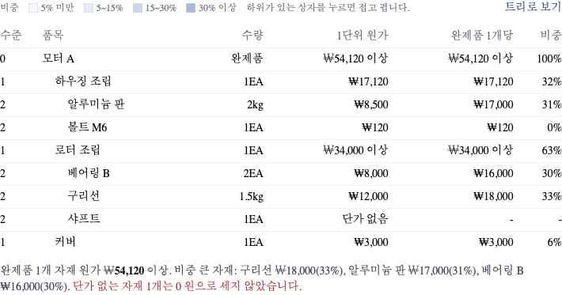
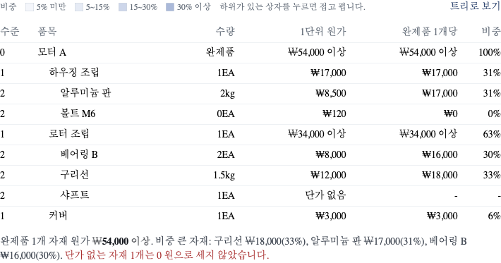

# BOM 상세에서 자식 부품 찾기

- 상태: 구현 및 로컬 재현 완료
- 출처: 생산 BOM 상세 트리 후속 개선. [기존 BOM 카드](2026-11-10_시각화_7_BOM_원가_롤업.md)
- 우선순위: 1 자재·원가 정합성, 2 오류·누락 표시, 3 첫 조작까지 걸리는 시간
- 브랜치 계획: `refac/bom-child-lookup`
- 크기 추정: 3시간씩 2회

## 현상과 재현

`src/app/(private)/production/utils/bomTreeUtils.ts`의 `transformBomDataToTree`는 노드마다 전체 배열을 훑어 자식을 찾는다. 데모 BOM은 9개 노드다. 합성 입력에서 반복 탐색의 비용을 관찰했고, 아래 전후 표에서 화면의 대기 시간을 따로 확인했다.

1. 데모 관리자로 `/production?tab=bom`에서 첫 BOM의 상세를 연다.
2. ‘로터 조립’에서 Enter를 눌러 ‘하위 3개 접힘’을 확인하고 Space로 다시 펼친다. 표로 전환해 단가 누락과 완제품 원가의 ‘이상’ 표시를 확인한다.
3. 같은 상세 응답의 `levelStructure`만 1,023개 합성 노드로 바꿔 같은 동작을 반복한다. 테스트에서 응답을 주입하고 기본 데모 데이터는 그대로 쓴다. 합성 입력에도 접을 조립품과 단가가 없는 자재를 둔다.

## 영향 범위와 결정 질문

- 진입점은 `BomTab → BomDetailModal → BomCostTree`다. 상세 조회는 `bomKeys.detail(bomId)`, 차트 로드는 기존 `next/dynamic`을 사용한다.
- 먼저 바꿀 곳은 `transformBomDataToTree`다. 부모 ID별 자식 목록을 한 번 만들면 추가 메모리를 쓰는 대신 전체 배열 반복 탐색을 줄일 수 있다. 루트 선택과 형제 코드 정렬은 기존 구현을 기준으로 한다.
- 완료 기준을 다른 변경 없이 달성할 수 있는가? 화면의 병목이 다른 곳으로 나오면 그 결과를 다음 카드에 넘긴다. 화면에서 확인된 포커스·스크롤 결함은 재현 동작과 위치를 기록한다.

## 완료 기준과 테스트 순서

| 먼저 고정할 동작                                                                                                                  | 기존 검증 위치와 추가할 확인                                                                    |
| --------------------------------------------------------------------------------------------------------------------------------- | ----------------------------------------------------------------------------------------------- |
| 정렬되지 않은 입력으로 같은 부모·자식과 형제 순서를 복원한다. 빈 입력과 루트 없는 입력의 결과, 잎의 수량·단가 누락도 기존과 같다. | `production/utils/buildBomTree.test.ts`에서 부족한 경우를 추가하고 수정 전에 실행               |
| 같은 자재 수량·비용을 요약, 트리, 표에서 확인한다.                                                                                | 기존 `bomCost.test.ts`, `BomCostTree.test.tsx` 재사용                                           |
| Enter로 접고 Space로 다시 펼친다. 포커스가 같은 조립품에 있고 펼침 상태를 읽을 수 있다. 휠로 긴 내용을 스크롤할 수 있다.          | 기존 `e2e/charts.spec.ts`의 BOM 사례에 빠진 키보드 검증을 보강하고 휠 동작은 실제 모달에서 확인 |

## 남길 수치와 전후 표

[기존 성능 측정](../../perf/measure.spec.ts)처럼 운영 빌드, 같은 Chrome·화면 크기, CPU 4배 감속, 각 조건 3회 중앙값과 개별 값을 사용한다. `playwright.perf.config.ts`의 로컬 서버는 3200 포트다. 화면 수치는 캐시 없는 첫 상세 열기와 같은 세션의 재열기를 구분한다. 성능 수치는 로컬 비교용으로 기록한다.

| 입력         | 비교할 버전        | 기록할 값                                                                   |
| ------------ | ------------------ | --------------------------------------------------------------------------- |
| 데모 9개     | 현재 / 인덱스 적용 | 상세 클릭 → 조립품 조작 가능, Enter → 접힘 표시가 그려진 시점, 표시 노드 수 |
| 합성 1,023개 | 현재 / 인덱스 적용 | 같은 화면 수치, 동일 입력으로 잰 변환 함수 시간                             |

Performance 기록에서 상세 응답과 차트 JS 로드, 변환·원가 계산, D3 배치, 그리기를 구분한다. 두 버전은 같은 데이터와 동일한 초기 펼침 상태로 잰다. 측정값이 겹치면 차이가 작거나 불확실하다고 기록한다.

## 리뷰와 결과 기록

테스트·타입·린트·빌드, BOM e2e, 독립 리뷰, 실제 화면 검증 순으로 마친다. 발견한 결함과 처리 결과는 `ai/reviews/`, 전후 값과 확인 방법은 이 카드의 findings, 선택 근거는 `ai/decisions.md`에 기록한다. 결과를 [라이브러리 비교 카드](2026-11-20_BOM_트리_라이브러리_비교.md)에 넘긴다.

## 전후 결과

BOM은 완제품 한 개에 어떤 조립품·자재가 얼마씩 들어가는지를 설명하는 자재명세서다. 입력은 부모 ID가 붙은 행 목록이고, 사용자는 이를 트리나 표로 확인한다. 이전에는 각 부품에서 전체 목록을 훑었다. 개선 후에는 부모 ID로 한 번 묶고 해당 자식 목록만 방문한다. 정렬은 양쪽 모두 형제 코드 순서다.

| 같은 입력에서 확인한 항목               |                   기존 |   부모별 인덱스 적용 | 해석                                                                        |
| --------------------------------------- | ---------------------: | -------------------: | --------------------------------------------------------------------------- |
| 합성 1,023개 행의 트리 변환 중앙값      |                11.1 ms |               0.2 ms | 입력 정규화와 계층 연결만 포함. 두 버전의 트리 직렬화 결과 일치             |
| 데모 9개에서 첫 상세 열기               |               659.4 ms |             660.0 ms | 화면이 더 빨리 열렸다는 근거 없음                                           |
| 합성 1,023개에서 첫 상세 열기           |               747.5 ms |             753.8 ms | 첫 조립품 DOM과 다음 프레임 기준. 사용자가 조립품을 눈으로 찾는 시간은 별도 |
| 합성 1,023개에서 Enter로 접기           |                77.5 ms |              78.1 ms | 접기에는 이미 변환한 트리를 재사용한다                                      |
| 볼트 M6 수량을 명시적 0으로 주입한 데모 | 1EA, 원가에 120원 기여 | 0EA, 원가에 0원 기여 | 별도로 재현한 정확성 수정. 단가 120원과 누락 자재 1건은 동일                |

화면은 운영 빌드 Chrome 157, CPU 4배 감속, 새 컨텍스트 3회의 중앙값이다. 클릭 이벤트부터 노드 상태를 확인한 다음 animation frame까지 측정했다. 함수는 같은 브라우저 조건에서 워밍업 5회 후 21회 중앙값이다. 데모 9개 함수 값은 측정 범위가 겹친다. 추가 메모리는 이번 실험에서 측정하지 않았다.

[변환 함수의 회차별 값](../experiments/2026-11-20_bom/phases.json) · [기존 모달의 개별 값](../experiments/2026-11-20_bom/before.json) · [인덱스 적용 모달의 개별 값](../experiments/2026-11-20_bom/index.json)

### 수량 0에서 무엇이 달라졌나

기존 `quantity || undefined`는 0을 누락 값으로 바꿨고, 원가 계산 기본값인 1이 적용됐다. API 타입은 수 또는 null을 받으므로 `quantity ?? undefined`로 명시된 0을 보존했다. 데모 BOM의 볼트 수량 한 칸에 0을 주입한 조건에서 완제품 원가는 **54,120원 이상 → 54,000원 이상**이다. 샤프트 단가는 계속 누락이어서 양쪽 모두 ‘이상’을 표시한다. 기본 데모의 볼트 수량은 8이다.

| 기존 표                                                                                 | 수정 후 표                                                                              |
| --------------------------------------------------------------------------------------- | --------------------------------------------------------------------------------------- |
|  |  |

### 다음 카드로 넘긴 실제 화면 문제

데모 9개에서는 Enter 접기, Space 재펼침, 조립품 포커스 유지, 원가 표를 확인했다. 합성 1,023개를 모두 펼쳤을 때 480px 높이의 첫 차트 영역에 완제품이 보이지 않았다. 완제품은 영역 상단에서 약 29,887px 아래에 있었다. 이를 라이브러리 선택 및 초기 표시 방식과 함께 검증한다. [최초 영역 캡처](../experiments/2026-11-20_bom/large-before.png) · [독립 리뷰](../reviews/2026-11-20_BOM_상세에서_자식_부품_찾기.md)
