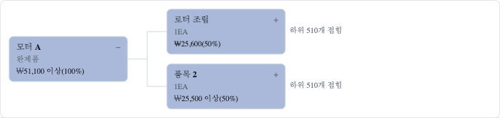

# BOM 트리 라이브러리 비교

- 상태: 후보 3개 실험, D3 채택 및 초기 표시 방식 개선
- 출처: [자식 부품 찾기 카드](2026-11-20_BOM_상세에서_자식_부품_찾기.md)의 화면 측정과 기존 BOM 카드. 비교 시작 시 첫 카드의 코드와 결과를 기준으로 삼는다.
- 우선순위: 1 원가와 계층 정합성, 2 누락 표시와 조작 보존, 3 체감 속도, 4 유지보수성
- 브랜치 계획: `refac/bom-tree-library`
- 크기 추정: 3시간씩 2회. 채택한 후보를 제품에 옮기는 작업은 선택 후 별도 카드로 산정한다.

## 현상과 결정 질문

현재 `bomLayout.ts`는 D3로 좌표를 계산하고 `BomCostTree.tsx`는 React로 SVG와 키보드 동작을 구현한다. 첫 질문은 컴포넌트에 배치·연결선·접기를 맡겼을 때 직접 관리할 코드가 실제로 줄어드는가다. 두 번째 질문은 화면 그리기가 병목일 때 렌더러를 바꾸면 첫 조회와 접기가 빨라지는가다.

## 비교 순서와 영향 범위

1. 첫 카드에서 검증한 데이터 변환, 원가 집계, 상세 모달, 요약, 표를 공통으로 쓴다. 비교할 경계는 트리 배치·노드와 연결선 그리기·접기 입력이다.
2. 기존 D3 + React SVG를 기준으로, 실험 브랜치에서 `react-d3-tree` 맞춤 노드에 같은 수량·원가·누락 표시를 연결한다. 같은 형제 순서·표시 개수·노드 크기, 같은 초기 펼침 깊이와 애니메이션 조건을 맞춘다.
3. 첫 카드에서 그리기가 가장 긴 구간으로 반복 관측되면 ECharts Tree의 Canvas도 같은 시나리오에 넣는다. 점검한 후보와 실험까지 진행한 후보를 결정 기록에 각각 표시한다.

## 완료 기준과 테스트 순서

- 먼저 기존 `BomCostTree.test.tsx`와 `e2e/charts.spec.ts`의 업무 동작을 후보에도 적용한다. 레이아웃 단위 테스트는 각 구현에서 검증할 배치 규칙을 확인한다.
- 같은 품목·수량·원가와 단가 누락을 읽을 수 있고, 키보드로 조립품 접기·펼치기, 포커스 확인, 표 전환, 모달 안 스크롤을 수행할 수 있어야 한다. 기존 리뷰에서 발견한 ‘하위 N개 접힘’ 문구 잘림과 표의 ‘이상’ 누락도 확인한다.
- 첫 카드와 같은 운영 빌드 측정 조건에서 데모 9개와 합성 1,023개를 비교한다. 후보별 표에 첫 조작·접기 지연, 상세를 처음 열 때 추가로 받은 JS 전송량, 직접 작성하는 배치·연결선·키보드 처리, 예상 교체 파일을 적는다.

| 결정        | 적용 조건                                                                                                                                                  |
| ----------- | ---------------------------------------------------------------------------------------------------------------------------------------------------------- |
| D3 유지     | 후보가 필수 동작을 충족하지 못하거나, 측정 오차와 회귀 비용을 고려했을 때 교체 이점이 작다.                                                                |
| 후보로 교체 | 필수 동작이 동등하고, 반복 측정에서 사용자 대기가 줄거나 직접 유지할 코드가 실질적으로 줄어든다. 추가 JS와 필요한 맞춤 코드까지 적어 채택 이유를 설명한다. |

## 리뷰와 결과 기록

후보별 전후 표와 직접 확인한 동작을 카드에 붙인다. 독립 리뷰와 로컬 화면 확인을 거쳐 최종 선택을 `ai/decisions.md`에 남긴다. 채택 시 다음 카드에서 BOM 상세의 배치·렌더링만 교체하고, [차트 디자인 지침](../../DESIGN_GUIDELINES.md)의 BOM 항목과 지연 로드 방식에 선택 근거를 반영한다. 실험용 의존성은 채택된 제품 코드에 필요한 것만 포함한다.

## 실제 선택과 전후

**D3를 유지하고 큰 트리의 첫 표시 방식을 바꿨다.** 첫 화면에서 완제품 상자를 끝까지 읽을 수 있는지 계산한다. 상자가 잘리면 첫 화면에 완제품과 직속 조립품부터 보여주며, 그것만으로도 넘치는 폭넓은 트리는 완제품부터 연다. 표는 전체 목록을, 요약은 전체 BOM의 원가를 사용한다.

| 합성 1,023개 · 같은 차트 영역의 처음         | 기존                                                            | 최종                                                                   |
| -------------------------------------------- | --------------------------------------------------------------- | ---------------------------------------------------------------------- |
| 실제 브라우저 캡처                           |  |  |
| 처음 그린 노드 / 완제품의 세로 위치          | 1,023개 / 영역 상단에서 29,887px 아래                           | 3개 / 영역 상단에서 52px 아래                                          |
| 첫 DOM 상태가 준비된 다음 프레임, 3회 중앙값 | 747.5ms                                                         | 658.1ms. 처음 그린 수와 펼침 상태가 다름                               |
| 깊이 9의 자재 ‘품목 511’을 트리에 표시       | 이미 펼쳐져 있음. 화면 안까지 이동하는 스크롤 비용은 미측정     | 필요한 가지 8번 펼침. 키보드 포커스 유지                               |
| 표와 원가                                    | 1,023행 · 51,100원 이상                                         | 1,023행 · 51,100원 이상                                                |

캡처는 같은 배율의 실제 스크롤 영역이다. 폭은 둘 다 710px, 실제 콘텐츠에 따른 높이는 기존 480px, 최종 168px였다. 데모 9개에서는 펼침·접힘 각각 기존과 최종 캡처의 SHA-256이 같다. 칸을 모두 펼치면 그리기 비용이 다시 생기며, 전체 원가와 최초 배치 계산은 큰 입력에서도 매번 필요하다.

### 같은 펼침 상태로 비교한 라이브러리

| 기준                                        | D3 + React SVG | react-d3-tree 3.6.7 | ECharts Canvas |
| ------------------------------------------- | -------------: | ------------------: | -------------: |
| 9개 첫 열기, ms                             |          660.0 |               659.1 |          709.2 |
| 1,023개 첫 열기, ms                         |          753.8 |               999.7 |          888.2 |
| 1,023개 로터 접기 / 같은 상세 재열기, ms    |   78.1 / 210.3 |       207.0 / 439.1 |  140.9 / 192.2 |
| 다시 펼친 뒤 조작 가능한 조립품, 원래 511개 |            511 |                 259 |            511 |
| 첫 상세 때 추가 JS 전송량, bytes            |         18,546 |              43,949 |        152,910 |

D3에서 업무 노드와 키보드 동작은 이미 구현돼 있었다. react-d3-tree는 배치와 접기를 제공하지만 이번 구현에서는 부모를 다시 열었을 때 하위의 펼침 상태가 달라졌다. 한글 텍스트 외곽선이 겹치는 문제는 별도 브라우저 실험에서 SVG text의 stroke를 제거해 보완 가능한 것도 확인했다. Canvas 후보는 키보드 조작을 위해 차트 좌표에 맞춘 HTML 버튼을 추가했다. 합성 BOM의 재열기는 D3보다 짧았고 첫 열기와 접기는 더 길었다. 후보의 JS 수치는 실제 실험 빌드가 받은 청크의 합이다. 라이브러리 패키지 단독 크기를 뜻하지 않는다.

### 검증과 재현

- 운영 빌드, Apple M5 / macOS 26.6.2 / Chrome 157, CPU 4배 감속, 화면 1440×1000, DPR 1. 각 버전·입력마다 새 컨텍스트 3회. 동일 응답 fixture를 Playwright에서 주입했다. 재열기는 같은 세션의 React Query·모듈 캐시를 사용한다.
- 첫 열기는 상세 클릭 이벤트부터 시험 대상 조립품의 DOM 상태 확인 후 다음 프레임까지다. 사람의 시선이나 실제 디스플레이의 픽셀 변경 시각은 측정하지 않았다. 최초 가시성은 노드와 스크롤 영역의 좌표 및 캡처로 따로 확인했다.
- 기준선은 `149083f8`, 인덱스 적용 버전은 `22778166`이다. 각 대상은 별도 체크아웃에서 같은 환경으로 운영 빌드해 실행하고, 계측 스크립트는 이 카드가 있는 체크아웃에서 대상 URL에 연결한다. 각 버전 실행 후 `node perf/bom-tree.mjs 'http://localhost:3200/production?tab=bom' /tmp/bom-evidence`로 샘플을 남긴다. 최종 단계적 표시 버전은 마지막 인수 `progressive`를 준다. 두 함수 버전은 `node perf/bom-phases.mjs 149083f8 /tmp/bom-evidence/fixture-demo.json /tmp/bom-evidence/fixture-1023.json`으로 비교할 수 있다.
- 후보는 별도 체크아웃 `149083f8`에서 [실험 패치](../experiments/2026-11-20_bom/library-candidates.patch.gz)를 풀어 적용한다. `gzip -dc <패치 파일> | git apply -`. 패치 속 실험 안내에 후보별 URL과 실행 순서가 있다. 두 후보와 동일한 전체 펼침 상태의 D3 측정에는 마지막 인수를 생략한다.
- 원자료는 [D3 전체 펼침](../experiments/2026-11-20_bom/index.json), [react-d3-tree](../experiments/2026-11-20_bom/react-d3-tree.json), [ECharts](../experiments/2026-11-20_bom/echarts.json), [D3 단계적 표시](../experiments/2026-11-20_bom/progressive.json), [직속 자재 30개·불완전한 입력](../experiments/2026-11-20_bom/wide-integrity.json)에 있다. 실제 공장의 BOM 크기 분포와 작업 소요시간은 확인 전이다.

[독립 리뷰 및 경계값 보완](../reviews/2026-11-20_BOM_트리_라이브러리_비교.md)
